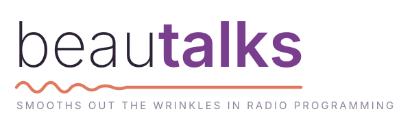

  <picture>
    <source media="(prefers-color-scheme: dark)" srcset="assets/brand/beautalks-logo-dark.svg">
    
  </picture>

# beautalks

Radio channel programming for handheld two-way radios (Baofeng and friends),
written in [Dado](https://github.com/dadolangcom/Dado).

- Auto-detects the connected radio model
- Reads, edits and writes channels, with automatic backups and verification
- Moves channel lists ("profiles") between different radio models, with a
  report of anything the destination radio can't hold
- Ships a library of known channel plans (FRS, GMRS, MURS, NOAA weather,
  marine, ham, Alaska-specific sets)
- Drivers update from this repo's GitHub releases

Status: early development. Reading is verified on a Baofeng UV-5RM and UV-5RE;
writing is not enabled yet.

Radio protocol and memory-layout knowledge is ported from
[CHIRP](https://chirpmyradio.com) (GPLv3). beautalks is licensed under the
GNU General Public License v3.0 or later; see `LICENSE`.

The logo is set in [Inter](https://rsms.me/inter/) (SIL Open Font License),
converted to outlines; `assets/brand/make_brand.py` regenerates it.
